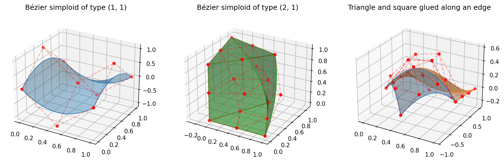

Bézier Simplex and Simploid Visualization
=========================================

Visualizing high-dimensional Bézier simplices and simploids is crucial for understanding the manifold structure and analyzing Pareto fronts. PyTorch-BSF provides high-level utilities to project and plot 2D and 3D Bézier manifolds.

The ``torch_bsf.plotting`` Module
---------------------------------

The ``plot_bezier_simplex()`` function provides a high-level API for visualization of a Bézier simplex, such as a model returned by :func:`torch_bsf.fit`. It automatically handles the dimensionality of your model.  For a Bézier simploid with more than one factor, use ``plot_bezier_simploid()`` (see :ref:`visualization-simploids`).

.. code-block:: python

   import torch
   import torch_bsf
   from torch_bsf.plotting import plot_bezier_simplex
   from torch_bsf.sampling import simplex_grid
   import matplotlib.pyplot as plt

   # Fit a model (e.g., a Bézier triangle in 3D)
   ts = simplex_grid(n_params=3, degree=6)
   xs = torch.stack([ts[:, 0], ts[:, 1], ts[:, 0] * ts[:, 1] * ts[:, 2]], dim=1)
   bs = torch_bsf.fit(params=ts, values=xs, degree=3)

   # Plot the model
   fig = plt.figure(figsize=(10, 8))
   ax = plot_bezier_simplex(bs, num=100)
   plt.title("Bézier Manifold in 3D Space")
   plt.show()

Supported Plot Types
--------------------

Bézier Curves (:math:`n\_params=2`)
^^^^^^^^^^^^^^^^^^^^^^^^^^^^^^^^^^^

For Bézier curves, the tool plots a smooth path.

*   **2D Values**: Plots a path in the XY plane.
*   **3D Values**: Plots a 3D path in XYZ space.
*   **Optional**: Control points and the "control polygon" can be displayed using ``show_control_points=True``.

Bézier Triangles (:math:`n\_params=3`)
^^^^^^^^^^^^^^^^^^^^^^^^^^^^^^^^^^^^^^

For Bézier triangles (surfaces), the tool uses triangulation to render a smooth manifold.

*   **2D Values**: Plots a projection of the surface into 2D space.
*   **3D Values**: Renders a smooth 3D surface using ``plot_trisurf``.
*   **Optional**: Control points and the underlying mesh can be displayed.

High-Dimensional Bézier Simplices (:math:`n\_params \geq 4`)
^^^^^^^^^^^^^^^^^^^^^^^^^^^^^^^^^^^^^^^^^^^^^^^^^^^^^^^^^^^^^

For high-dimensional Bézier simplices, the function creates a **pairwise scatter
plot** (pair plot) of the output values.

*   **Diagonal panels**: Histograms showing the distribution of each output
    dimension individually.
*   **Off-diagonal panels**: Scatter plots showing the relationship between
    every pair of output dimensions.
*   **Optional**: Control points are overlaid on off-diagonal panels and as
    vertical lines on diagonal panels when ``show_control_points=True``.

The return value is a 2-D ``numpy.ndarray`` of ``matplotlib.axes.Axes`` with
shape ``(n_values, n_values)``.

.. code-block:: python

   from torch_bsf import BezierSimploid
   from torch_bsf.plotting import plot_bezier_simplex
   import matplotlib.pyplot as plt

   # Build a random degree-2 model on a 3-simplex (n_params=4) with 3 outputs
   model = BezierSimploid.randn((3,), 2, 3)

   # Plot returns an (n_values, n_values) grid of axes
   axes = plot_bezier_simplex(model, num=30)
   axes[0, 1].set_xlabel("Objective 2")
   axes[1, 0].set_ylabel("Objective 1")
   plt.suptitle("Pairwise Plot of High-Dimensional Bézier Simplex")
   plt.tight_layout()
   plt.show()

Customizing the Plot
--------------------

The ``plot_bezier_simplex()`` function returns a standard Matplotlib axes object (``Axes`` or ``Axes3D``) for low-dimensional models, and a 2-D array of ``Axes`` for high-dimensional models. You can customize labels, titles, and styles using the standard Matplotlib API.

.. code-block:: python

   ax = plot_bezier_simplex(bs, num=100, color="blue")
   ax.set_xlabel("Objective 1")
   ax.set_ylabel("Objective 2")
   ax.set_zlabel("Objective 3")
   ax.view_init(elev=20, azim=45)

.. _visualization-simploids:

Bézier Simploids and Simploidal Bézier Spaces
---------------------------------------------

Models of the :doc:`simploidal` module have their own plotting functions:

*   ``plot_bezier_simploid(model, num=20, ax=None, show_control_points=True, **kwargs)``
    draws a :class:`~torch_bsf.simploidal.BezierSimploid`.
*   ``plot_simploidal_bezier_space(space, num=20, ax=None, show_control_points=True, **kwargs)``
    draws every main simploid of a :class:`~torch_bsf.simploidal.SimploidalBezierSpace`
    on one axes, each piece in its own color of the Matplotlib color cycle
    (pass ``color=...`` to use one color for all pieces).

Both support models with ``n_values`` of 2 (a 2D axes) or 3 (a 3D axes) and
raise ``ValueError`` otherwise.  ``num`` is the number of grid intervals along
each edge of the parameter domain.  How a piece is drawn depends on the
dimension of its simploid type:

.. list-table::
   :header-rows: 1
   :widths: 30 70

   * - Simploid
     - Drawn as
   * - vertex ``()``
     - a point
   * - edge ``(1,)``
     - a curve (``ax.plot``)
   * - triangle ``(2,)``, square ``(1, 1)``
     - a triangulated surface (``ax.plot_trisurf`` in 3D, a ``PolyCollection`` in 2D) with its boundary curves
   * - dimension 3 or more, e.g. ``(2, 1)``, ``(1, 1, 1)``, ``(3,)``
     - the surfaces of all its 2-dimensional faces (the boundary of the solid)

With ``show_control_points=True`` (the default) the control net is drawn as
red points joined by dashed segments: two control points are joined when their
indices differ by :math:`e_k - e_l` in a single factor, which gives the
triangular net of a simplex factor and the grid of a cube.

.. code-block:: python

   import torch
   from torch_bsf.plotting import plot_simploidal_bezier_space
   from torch_bsf.simploidal import SimploidalSet, SimploidalBezierSpace

   S = SimploidalSet()
   tri, sq = S.add_simplex(2), S.add_simploid((1, 1))
   S.identify(tri.face(0, 2), sq.face(1, 1))  # glue the two along an edge

   space = SimploidalBezierSpace(S, degree=2, n_values=3)
   torch.nn.init.normal_(space.proper_control_points)

   ax = plot_simploidal_bezier_space(space, num=20)
   ax.set_title("A triangle and a square sharing an edge")

   Bézier simploids of types :math:`(1, 1)` and :math:`(2, 1)`, and a simploidal
   Bézier space made of a triangle and a square sharing an edge.
   Generated by ``examples/generate_simploidal_plot.py``.

Why Visualize?
--------------

1.  **Validation**: See how well the Bézier simplex or simploid fits your training observations.
2.  **Pareto Front Analysis**: Analyze the shape and tradeoff of your Pareto front in multi-objective optimization.
3.  **Communication**: Clearly communicate the structure of high-dimensional manifolds to stakeholders.
