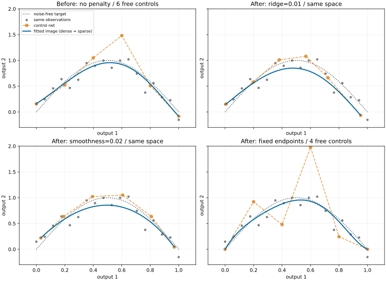

Visualization
=============

What to inspect before trusting a fit
-------------------------------------

Plot observations, predicted images and residuals before reducing a result to
one MSE. A low mean error can hide endpoint bias, oscillation between sparse
measurements or an outlier in one response. A control net can reveal how a
penalty changes the fitted geometry, while a parameter-space error graph
shows where additional observations are needed.

Install ``pytorch-bsf[plot]`` for plotting. ``plot_model`` draws the image of a
model using two or three selected output coordinates. For one scalar output
against a parameter, evaluate the model on ``grid`` points and use ordinary
Matplotlib lines. These views answer different questions; label axes so that
a reader knows whether the horizontal coordinate is a parameter or a response.

Plot observations and fitted image
----------------------------------

.. testcode:: visualization
    :skipif: __import__("importlib.util").util.find_spec("matplotlib") is None

    import torch
    import matplotlib
    matplotlib.use("Agg")
    import matplotlib.pyplot as plt
    from torch_bsf import BezierSpace, Samples, fit
    from torch_bsf.plotting import plot_model

    x = torch.linspace(0, 1, 18, dtype=torch.float64)
    t = torch.stack([1 - x, x], dim=1)
    values = torch.stack([x, torch.sin(torch.pi * x)], dim=1)
    result = fit(BezierSpace.simplex(1, degree=3), Samples(t, values)).require_success()
    fig, ax = plt.subplots()
    ax.scatter(values[:, 0], values[:, 1], color="black", label="observations")
    plot_model(result.model, ax=ax, resolution=40, coordinates=(0, 1),
               show_controls=True, color="C0")
    ax.set(xlabel="first output", ylabel="second output")
    ax.legend()
    plt.close(fig)

The example chooses a graph-shaped image by fitting both ``x`` and its
response. ``plot_model`` does not automatically append an input coordinate to
a scalar model's output. For an existing scalar model, explicitly plot
``points.parameters[:, 1]`` against ``model(points)[:, 0]`` instead of trying
to request a nonexistent second output.

``plot_model`` returns the axes. Pass ``ax`` to overlay models, observations,
or an analytic reference, and call ``ax.figure.savefig(...)`` to export.
Use a three-dimensional axes object for three selected outputs. With more
than three outputs, select a meaningful pair or triple via ``coordinates``;
indices must be distinct, in range, and have length two or three. Different
projections can hide different errors, so check omitted outputs numerically.

Tune display settings
---------------------

.. list-table:: Plot options and their effects
   :header-rows: 1
   :widths: 23 42 35

   * - Setting
     - Increasing or changing it does this
     - Interpretation
   * - ``resolution``
     - Evaluates a denser mesh inside each plotted cell or face.
     - Smoother rendering, greater evaluation cost; coefficients stay fixed.
   * - ``coordinates``
     - Selects another two- or three-output projection.
     - Can expose features hidden by the previous projection.
   * - ``show_controls``
     - Displays or hides the coefficient net.
     - Controls explain representation, but interior controls are not observations.
   * - ``color`` and plotting keywords
     - Changes visual styling on the supplied axes.
     - Use consistent styles when comparing conditions.

Choose common axis limits for before/after panels; autoscaling each panel
independently can make a small change look dramatic or hide large shrinkage.
Show the same observation markers and identify which settings changed. Do
not smooth a residual plot so aggressively that localized errors disappear.
When output units differ greatly, use separate axes or explicit scaled views,
and report which units are being shown.

   The same degree-five space and 18 noisy observations before and after
   ridge, smoothness or endpoint constraints. Blue curves show model images;
   orange polygons show controls. Common axes make shrinkage and endpoint
   changes comparable. See :doc:`regularization` for the objective and weights.

This existing figure is regenerated by
``python examples/generate_regularization_comparison.py`` with plot and sparse
extras. Dense/sparse prediction agreement is checked before rendering. The
figure shows a real change of fitted coefficients; the resolution comparison
in :doc:`grid_sampling` shows a change of display density only.

Residuals, boundaries and assembled domains
-------------------------------------------

For observed points, compute ``prediction - samples.values`` and plot it
against the relevant parameter coordinate. Inspect signed residuals to detect
systematic bias and absolute or squared residuals to identify large local
errors. For weighted observations, show which points have large weights;
a tiny weighted MSE can coexist with large errors at nearly ignored rows.
For independent test responses, use the same coordinates and units in both
before/after plots.

``plot_model`` draws maximal cells on shared axes. Shared face controls encode
C0 agreement, so overlapping boundaries can be visually indistinguishable.
Check explicit face predictions numerically when testing continuity. Domains
above dimension two are displayed through their two-dimensional faces, not
as filled high-dimensional interiors. An attractive boundary view does not
establish that the interior is accurate or non-self-intersecting.

A control net illustrates coefficient locations and adjacency; it is not the
surface itself. Ridge can move controls toward zero, and smoothness can bring
neighbors together, without changing degree or topology. Exact subdivision
changes local control nets while preserving the image. Compare actual model
values on parent-mapped points when investigating a split, as shown in
:doc:`splitting`.

Every new guide figure can be reproduced with
``python examples/generate_guide_figures.py``. Seeds, sample counts and measured
errors are retained in :download:`the metrics JSON <../_static/guides/metrics.json>`.
The figures are synthetic illustrations of specific settings, not general
accuracy or hardware performance claims. Keep numerical status and held-out
errors alongside visual evidence when assessing a model for deployment.
